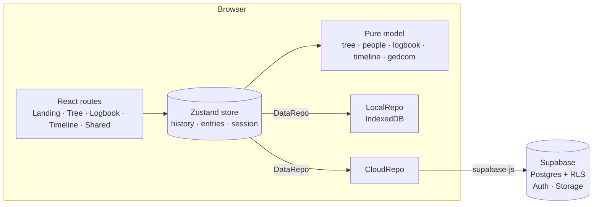

# Family Tree

An heirloom family-tree builder with a royal, manuscript-inspired design. Build your tree with
portrait medallions, record every memory in a **Logbook** where each entry has its own page, follow
your family's story on a **Timeline**, and keep it all safe in your account.

**Live:** https://arbhadra.github.io/famtree/

## Features

- **Scrolling landing page** with an animated tree, how-it-works steps, a feature tour, and sign-in.
- **One family map with everyone on it**, built for complex families:
  - Several partners per person, each with a status (married, partner, engaged, separated,
    divorced, widowed) and years. Children are added _with a specific partner_ and drawn under
    that couple, so half-siblings sort themselves out.
  - Birth, adoptive, step, foster and guardian parent links, each drawn with its own line style.
  - Full or half siblings (choose which parent they share). Step-parents are added as a parent's
    partner.
  - Relationships are computed, not typed: stepmother, half-brother, great-aunt, uncle by
    marriage, step-grandfather, second cousin once removed, ex-wife, and more. You can override any
    label (for example "Nani" or "Godfather").
  - Nobody is hidden for being distant or not related by blood: step-grandparents,
    grandparents' siblings and in-laws' families all appear. Views for everyone, blood relatives
    only, or your direct line. Fit-to-screen and collapsible branches.
- **Default portraits**: until you add a photo, each person gets a drawn portrait for their gender
  and life stage (baby, child, teen, adult, elder). Age comes from the birth year, from age at
  death, or is estimated from their generation. People who have died are shown in muted sepia
  with a mourning ribbon.
- **Tree editor**:
  - Guided entry: a new relative opens straight into its details with the name field focused.
  - Each person has name, gender, born, died, birthplace, occupation, notes and a cropped photo,
    plus Details, Relatives and Records tabs.
  - Find anyone with <kbd>Ctrl/⌘ K</kbd>; undo and redo with <kbd>Ctrl/⌘ Z</kbd> / <kbd>Shift</kbd>.
  - Zoom, pan, pinch.
- **Logbook** (top-right of every screen): memories, events, migrations, recipes and documents.
  - Each entry has a page with a rich-text story (TipTap), exact or approximate dates
    (`on / about / before / after / between`), place, tagged people, photos and PDFs, sources, draft
    or complete status, and a needs-verification flag.
  - Search, filter by type or person, and sort. Autosaves as you type. Print any page to PDF.
- **Timeline** of births, marriages, divorces, passings and logbook entries, grouped by decade.
- **Family charts** (Charts tab): four classic, printable views, each centred on anyone you choose.
  - **Ancestors**: a traditional pedigree chart, from you on the left to your great-grandparents
    on the right.
  - **Descendants**: one ancestor at the top and every generation below, with partners side by
    side and each couple's children grouped under them.
  - **Fan chart**: generations of ancestors as rings around you.
  - **Outline**: a compact, indented vertical tree for documents and reports.
  - Two styles, Parchment (made for printing) and Royal night. Export as a high-resolution
    **PNG**, a **PDF** fitted to A4, A3 or Letter, or **SVG**, with the fonts embedded, or print
    directly.
- **CSV export and import**: edit the whole tree as text or in a spreadsheet, then load it back
  (see [CSV format](#csv-format)).
- **Thanks & credits** page (`/credits`), mirrored in [`credits.txt`](credits.txt).
- **Accounts and cloud save** (Supabase): email/password or Google. Your guest tree moves into your
  account on first sign-in. Row-level security keeps every row private to its owner.
- **Read-only share links**, **GEDCOM export** for other genealogy software, **PNG export**, and
  **JSON backup and restore**.
- **Guest mode** without an account: everything is stored in IndexedDB in your browser.

## Stack

| Layer    | Tools                                                                        |
| -------- | ---------------------------------------------------------------------------- |
| Frontend | React 19, TypeScript (strict), Vite, React Router                            |
| State    | Zustand: one store with undo history and debounced autosave                  |
| Editor   | TipTap (ProseMirror)                                                         |
| Backend  | Supabase: Postgres, Auth, Storage, row-level security, RPC functions         |
| Offline  | IndexedDB via `idb-keyval`                                                   |
| Styling  | Hand-written CSS on design tokens, with Cinzel and Cormorant Garamond fonts  |
| Quality  | Vitest (unit), Playwright (end-to-end, desktop and mobile), ESLint, Prettier |
| CI/CD    | GitHub Actions: lint, typecheck, test, e2e, deploy to GitHub Pages           |

## Architecture



- `src/model`: framework-free, fully unit-tested logic. The tree is a flat id graph
  (`people[id].parents / spouses`), and children and siblings are derived by query. Every mutation
  returns a new state, which makes undo/redo a simple history stack.
  - `layout.ts` is a custom layered layout for family graphs. Generations become rows and
    partners form clusters, with a person who has several partners in the middle. Barycenter
    sweeps order each row so children sit under their own couple, and each row's x positions are
    solved as a weighted isotonic regression (pool-adjacent-violators). That keeps every
    family centred without overlaps. Edges are computed here too, so the renderer just draws them.
  - `kinship.ts` names relationships from the nearest common ancestor (degree and removal for
    cousins), then partners, in-laws, step-family and ex-partners.
  - `age.ts` picks each default portrait's life stage, and `view.ts` decides who is visible.
- `src/data`: one `DataRepo` interface with two implementations. The store swaps between them when
  you sign in or out, so the UI never knows where data lives.
- `src/store`: the app store, autosave (debounced per tree and per entry), and session boot.
- `src/routes` and `src/components`: the UI.
- `supabase/migrations`: schema, policies, storage bucket and share functions.
- `legacy/index.html`: the original single-file version this project grew from. Trees saved by it
  still load.

## CSV format

The tree menu (⋯) has **Export CSV** and **Import CSV…**. Importing replaces the tree but keeps
your logbook, and it can be undone. There is one row per person, and the columns can be in any
order:

| Column                                                      | Meaning                                                                                                                      |
| ----------------------------------------------------------- | ---------------------------------------------------------------------------------------------------------------------------- |
| `id`                                                        | Any unique text without `;` or `:`. Used by `parents` and `partners`.                                                        |
| `name`, `born`, `died`, `birthplace`, `occupation`, `notes` | Free text.                                                                                                                   |
| `gender`                                                    | `male`, `female` or `other` (`m` and `f` work too).                                                                          |
| `label`                                                     | An optional custom relationship label, like "Nani".                                                                          |
| `parents`                                                   | Parent ids separated by `;`. Add `:adopted`, `:step`, `:foster` or `:guardian` for a non-birth link, e.g. `dad;mum:adopted`. |
| `partners`                                                  | Partner ids separated by `;`, with an optional status and years, e.g. `anna:divorced:2012:2016;beth:married:2019`.           |
| `me`                                                        | `yes` on your own row.                                                                                                       |

```csv
id,name,gender,born,parents,partners,me
me,Arnab Bhadra,male,1990,dad;mum,beth:married:2019,yes
dad,Ravi Bhadra,male,1958,,mum:divorced:1986:1996,
mum,Mira Sen,female,1962,,,
beth,Beth Moore,female,1991,,,
```

Photos aren't stored in the CSV. People whose ids match someone already in your tree keep their
photo. Problems such as an unknown id are listed before you confirm the import.

## Develop

```bash
npm install
npm run dev        # http://localhost:5173
npm test           # unit tests
npm run e2e        # Playwright end-to-end tests (builds and serves the app)
npm run lint && npm run typecheck
```

Without Supabase keys the app runs in guest mode, which is fully functional and stores data in the browser.

## Turn on accounts (Supabase, free tier)

1. Create a project at [supabase.com](https://supabase.com).
2. In the **SQL editor**, run `supabase/migrations/0001_init.sql`.
3. Under **Authentication → URL configuration**, set the Site URL to
   `https://<user>.github.io/famtree/` and add it (plus `http://localhost:5173/`) to the redirect URLs.
4. Optional: enable **Google** under Authentication → Providers.
5. Copy **Project URL** and **anon public key** from Project Settings → API:
   - For local development, put them in `.env.local` (see `.env.example`).
   - For the live site, add them as repository secrets `VITE_SUPABASE_URL` and
     `VITE_SUPABASE_ANON_KEY` (Settings → Secrets and variables → Actions), then re-run the deploy.

The anon key is designed to be public. Row-level security policies decide what each signed-in user
can read and write, and the media bucket only allows access to files under the user's own folder.

## Deploy (GitHub Pages, free)

`.github/workflows/deploy.yml` builds and publishes on every push to `main`. One-time setup:
**Settings → Pages → Build and deployment → Source: GitHub Actions**.

The build sets the base path to `/<repo>/` and copies `index.html` to `404.html`, so deep links
such as `/famtree/logbook/<id>` work on Pages.
