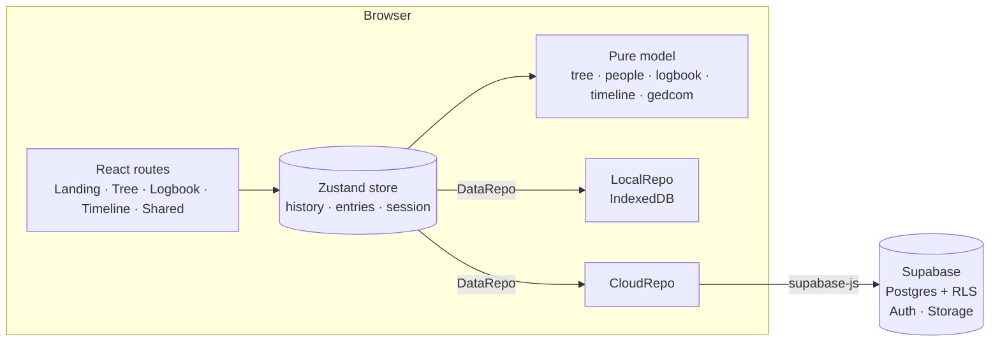

# Family Tree

An heirloom family-tree builder with a royal, manuscript-inspired design. Build your tree with
portrait medallions, record every memory in a **Logbook** where each entry has its own page, follow
your family's story on a **Timeline**, and keep it all safe in your account.

**Live:** https://arbhadra.github.io/famtree/

## Features

- **Scrolling landing page** with an animated tree, how-it-works steps, a feature tour, and sign-in.
- **Tree editor**: add parents, partners, siblings and children. Relationships are named
  automatically on both sides of the family (grandmother, father-in-law, great-grandson…).
  - Guided entry: a new relative opens straight into its details with the name field focused.
  - Details for each person: name, relationship, gender, born, died, birthplace, occupation, notes, and a cropped portrait.
  - Relatives and Records tabs on each person, plus a jump-to list of their family.
  - Find anyone with <kbd>Ctrl/⌘ K</kbd>; undo and redo with <kbd>Ctrl/⌘ Z</kbd> / <kbd>Shift</kbd>.
  - Zoom, pan, pinch, collapse branches.
- **Logbook** (top-right of every screen): memories, events, migrations, recipes and documents.
  - Each entry has a page with a rich-text story (TipTap), exact or approximate dates
    (`on / about / before / after / between`), place, tagged people, photos and PDFs, sources, draft
    or complete status, and a needs-verification flag.
  - Search, filter by type or person, and sort. Autosaves as you type. Print any page to PDF.
- **Timeline** of births, passings and logbook entries, grouped by decade.
- **Accounts and cloud save** (Supabase): email/password or Google. Your guest tree moves into your
  account on first sign-in. Row-level security keeps every row private to its owner.
- **Read-only share links**, **GEDCOM export** for other genealogy software, **PNG export**, and
  **JSON backup and restore**.
- **Guest mode** without an account: everything is stored in IndexedDB in your browser.

## Stack

| Layer    | Tools                                                                        |
| -------- | ---------------------------------------------------------------------------- |
| Frontend | React 19, TypeScript (strict), Vite, React Router                            |
| State    | Zustand: one store with undo history and debounced autosave                  |
| Editor   | TipTap (ProseMirror)                                                         |
| Backend  | Supabase: Postgres, Auth, Storage, row-level security, RPC functions         |
| Offline  | IndexedDB via `idb-keyval`                                                   |
| Styling  | Hand-written CSS on design tokens, with Cinzel and Cormorant Garamond fonts  |
| Quality  | Vitest (unit), Playwright (end-to-end, desktop and mobile), ESLint, Prettier |
| CI/CD    | GitHub Actions: lint, typecheck, test, e2e, deploy to GitHub Pages           |

## Architecture



- `src/model`: framework-free, fully unit-tested logic. The tree is a flat id graph
  (`people[id].parents / spouses`), and children and siblings are derived by query. Every mutation
  returns a new state, which makes undo/redo a simple history stack.
- `src/data`: one `DataRepo` interface with two implementations. The store swaps between them when
  you sign in or out, so the UI never knows where data lives.
- `src/store`: the app store, autosave (debounced per tree and per entry), and session boot.
- `src/routes` and `src/components`: the UI.
- `supabase/migrations`: schema, policies, storage bucket and share functions.
- `legacy/index.html`: the original single-file version this project grew from. Trees saved by it
  still load.

## Develop

```bash
npm install
npm run dev        # http://localhost:5173
npm test           # unit tests
npm run e2e        # Playwright end-to-end tests (builds and serves the app)
npm run lint && npm run typecheck
```

Without Supabase keys the app runs in guest mode, which is fully functional and stores data in the browser.

## Turn on accounts (Supabase, free tier)

1. Create a project at [supabase.com](https://supabase.com).
2. In the **SQL editor**, run `supabase/migrations/0001_init.sql`.
3. Under **Authentication → URL configuration**, set the Site URL to
   `https://<user>.github.io/famtree/` and add it (plus `http://localhost:5173/`) to the redirect URLs.
4. Optional: enable **Google** under Authentication → Providers.
5. Copy **Project URL** and **anon public key** from Project Settings → API:
   - For local development, put them in `.env.local` (see `.env.example`).
   - For the live site, add them as repository secrets `VITE_SUPABASE_URL` and
     `VITE_SUPABASE_ANON_KEY` (Settings → Secrets and variables → Actions), then re-run the deploy.

The anon key is designed to be public. Row-level security policies decide what each signed-in user
can read and write, and the media bucket only allows access to files under the user's own folder.

## Deploy (GitHub Pages, free)

`.github/workflows/deploy.yml` builds and publishes on every push to `main`. One-time setup:
**Settings → Pages → Build and deployment → Source: GitHub Actions**.

The build sets the base path to `/<repo>/` and copies `index.html` to `404.html`, so deep links
such as `/famtree/logbook/<id>` work on Pages.
